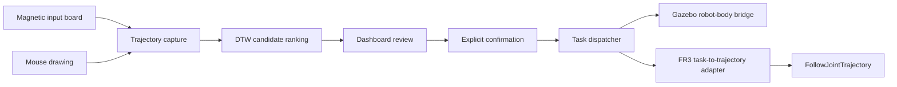

# Magnetic Trajectory Robot Interface

English | [简体中文](README.zh-CN.md)

Draw a symbol on a magnetic board or with the mouse. The system recognizes it, and once you confirm, the robot runs the matching task. A second mode lets you drive the end effector directly. Built on ROS1 Noetic, running against a Gazebo Panda or a Franka FR3.

This is my portfolio copy of a collaborative project. What I did, who else contributed, and what was and was not tested on hardware are at the end.

## Demo (Gazebo)

`TASK`: a mouse-drawn `2` is recognized and confirmed on the `C` dwell button. The robot-body bridge then runs the mapped hexagon motion.


`TELEOP`: keyboard Cartesian control and the Gazebo gripper pick up a 5 cm cube and put it on the green pad.


Both clips are real-time screen captures of Gazebo running headless in Docker. They are not real-hardware footage. Mouse and key input come from `xdotool` scripts. In the pick-and-place, the script releases each key based on the measured flange position. The `TASK` clip was recorded at `cef908c` with `visible_bridge_motion_scale:=3.0 visible_bridge_motion_duration_sec:=4.0`. The `TELEOP` clip was recorded at `35df0ec` with `spawn_pick_objects:=true`, using the scripts in [scripts/demo](scripts/demo/README.md).

## Two modes

- `TASK`: the drawn trajectory is compared against a DTW template bank, and the best candidates are shown. Nothing reaches the robot until the operator confirms one.
- `TELEOP`: continuous Cartesian control. A shared C++ core converts the input into joint targets with damped-least-squares inverse kinematics.

| Backend | `TASK` | `TELEOP` |
| --- | --- | --- |
| Gazebo | Recognized symbol runs a task | Keyboard Cartesian control and gripper |
| Real FR3 | Discrete tasks | Magnetic-board Cartesian control |

The system starts in `TASK`, and the dashboard switches modes. A mode switch only changes which mode owns the command path. It does not start Gazebo, open the serial port, connect to an FR3, load a controller, approve calibration, or enable physical commands.

How much each route has been tested:

- Gazebo `TELEOP` has run end to end: keyboard input, `Fr3CartesianTeleopCore`, the simulated trajectory controller, the Panda moving, and a pick-and-place with the simulated gripper. On every pull request, the CI job `gazebo-smoke` checks mode gating, Cartesian motion, and gripper open/close again.
- The Real-FR3 Cartesian and discrete adapters compile and are in the launch graph. Physical Real-FR3 `TELEOP` has never been run.

Details: [Dual-Mode Teleoperation](docs/DUAL_MODE_TELEOPERATION.md).

## From drawing to robot motion



The recognizer normalizes the finished trajectory and compares it with the DTW bank. It then publishes ranked candidates on `/colmag/symbol_candidates`. Confidence and margin gates reject unclear samples. The dashboard publishes `/colmag/confirmed_label` only after `C Confirm`. The dispatcher is the only node that publishes `/colmag/task_command`, and it maps labels to a fixed task vocabulary. A candidate on screen therefore cannot start motion. Recognition, confirmation, dispatch, and execution are separate steps. See [Architecture](docs/ARCHITECTURE.md) for the components and topics.

The tracked bank covers `1,2,3,V,O,X,A,C`. It was built from user-handwritten mouse seeds, and every template keeps its provenance fields. The feature and bank code is plain Python with no ROS dependency. The offline build and evaluation tools are described in [Running](docs/RUNNING.md#dtw-template-bank).

## Board and mouse

The serial magnetic board and the mouse share one dashboard. On the board, a magnetic-orientation clutch decides when the pen is drawing. Moving between the drawing area and the buttons is therefore not recorded.

| | Board | Mouse |
| --- | --- | --- |
| Draw | Orientation clutch plus drawing zone | Mouse stroke in the dashboard |
| Recognize | `B Recognize` | Automatic after the stroke ends |
| Confirm | `C Confirm` | `C Confirm` |
| Clear | `X Clear` | `X Clear` |
| Moves between areas | Clutch disengaged, not recorded | Not an issue |

See [Interaction Profiles](docs/INTERACTION_PROFILES.md).

## Backends

- Gazebo `TASK`: a simulation-only bridge builds bounded Panda joint trajectories and sends them through a `FollowJointTrajectory` action.
- Gazebo `TELEOP`: keyboard input goes through `Fr3CartesianTeleopCore`, which publishes bounded `JointTrajectory` commands to the controller. `O` and `C` in the keyboard terminal open and close the simulated Panda hand. They go through a separate bridge to the `franka_gripper` actions. This bridge accepts commands only in `TELEOP`. `spawn_pick_objects:=true` adds a cube and a place pad.
- Real FR3 `TASK`: a C++ adapter checks each accepted discrete command and builds a bounded trajectory for the standard controller.
- Real FR3 `TELEOP`: the board position goes through the same Cartesian core and a separately gated controller adapter.

Each backend has conservative defaults and its own gates. pytest starts none of them. The `gazebo-smoke` CI job starts only the Gazebo `TELEOP` profile, with headless Gazebo. Real-robot motion stays off until every environment, revision, network, controller, calibration, and physical safety gate passes. See [Hardware Boundaries](docs/HARDWARE_BOUNDARIES.md).

## Technology stack

| Layer | Technology |
| --- | --- |
| Middleware | ROS1 Noetic, catkin, `rospy`, `roscpp` |
| Recognition | Python, DTW, JSON template bank |
| Interface | Tk dashboard and ROS topics |
| Simulation | Gazebo, Panda model, `control_msgs/FollowJointTrajectory` |
| Hardware interface | C++, `franka_ros`, `libfranka`, joint trajectory controller |
| Packaging | Docker, Docker Compose, OCI revision labels |
| Validation | pytest, ruff, GitHub Actions, ROS-free C++ safety tests, catkin build |

## Repository layout

```text
colmag_ros/                ROS package
  scripts/                 ROS node entry points (dashboard, recognizer, dispatcher, ...)
  src/colmag_ros/          ROS-free Python modules, including the dashboard mixins
  src/*.cpp, include/      FR3 adapters, Cartesian core, and C++ safety helpers
  launch/, config/         Launch files, controller settings, DTW bank
colmag_gazebo_stub/        Gazebo robot-body bridge package
src/serial_mvp/            Serial packet parser and source abstraction
scripts/                   Offline DTW tools and guarded FR3 operator helpers
  ci/                      Gazebo runtime smoke test used by CI
  demo/                    Scripted recording of the pick-and-place GIF
docker/                    Gazebo and FR3 build and runtime profiles
tests/                     pytest suite, headless dashboard harness, C++ tests
docs/                      Architecture, running, validation, and boundary docs
.github/workflows/         CI: pytest (with and without ROS), ruff, catkin build, Gazebo smoke
```

ROS identifiers keep the original `colmag` namespace. Some runtime identifiers also keep the old milestone prefix (`m104…`), because other parts depend on them:

- the tracked DTW bank file that the launch defaults and the Docker image point to;
- the dispatcher mapping name `m104c4_8symbol_gazebo`;
- two ROS node names;
- the real-board sample record schema;
- the FR3 operator log directory under `outputs/`.

No file or module name has this prefix, except the bank file.

## Quick start

Run the tests. ROS Noetic is not needed. Tests that import ROS packages skip themselves without it.

```bash
python3 -m pip install -r requirements.txt
python3 -m pytest -p no:cacheprovider -q
```

Build the Mouse-to-Gazebo image from the current revision:

```bash
COLMAG_GIT_SHA="$(git rev-parse HEAD)" \
docker compose -f docker/compose.yaml \
  --profile mouse-gazebo build mouse-gazebo
```

Start the simulation. This opens the Gazebo and dashboard windows.

```bash
docker/run_gazebo_demo.sh mouse-gazebo
```

The FR3 profiles are not covered here. Read [Running](docs/RUNNING.md) before you use the serial board, the simulation, or hardware.

## Validation

CI runs on every pull request and every push to `main`:

- `ruff check`;
- pytest on Python 3.10 without ROS;
- pytest in a ROS Noetic container, plus a parse of the launch files that need no Gazebo or FR3 packages;
- `catkin_make install` for both ROS packages;
- the Gazebo smoke test: build the image, run the keyboard `TELEOP` profile with headless Gazebo, and check mode gating, Cartesian motion, and gripper open/close.

The tests cover:

- Python static and unit contracts, and the ROS-free C++ safety helpers;
- Markdown and image links, with case-sensitive paths;
- Docker images, Compose profiles, and launchers;
- launch file XML, route isolation, and install lists;
- that no generated `outputs/` files are tracked.

At export, I checked this edition by hand for secrets, private network values, personal absolute paths, identity-bearing files, nontechnical process material, and wording that could suggest sole authorship. CI does not repeat these checks.

[Validation](docs/VALIDATION.md) lists the commands and the CI jobs. It also states what each layer does not prove.

## Known limitations

- This is a research and demo stack, not a certified robot product.
- DTW quality depends on trajectory quality and template coverage.
- The board's orientation clutch is an application convention, not a safety-rated sensor mode.
- Static and unit tests say nothing about live ROS timing, how the GUI renders, Gazebo motion, or physical FR3 safety.
- Gazebo Cartesian `TELEOP` has runtime evidence. Physical Real-FR3 Cartesian `TELEOP` does not.
- The gripper exists only in Gazebo. There is no Real-FR3 gripper route.
- The Gazebo smoke test is one short scripted run. It does not cover the GUI, timing under load, or grasp quality.
- The FR3 route depends on specific upstream versions. Requalify it when the environment changes.

## My contribution

The table below is supported by the fixed branch history, the source ownership map, the implementation files, and the recorded validation evidence.

| Area | Contribution |
| --- | --- |
| Interaction design | Designed and implemented the Board interaction clutch and the distinct Board/Mouse profiles. |
| Recognition integration | Implemented and integrated the DTW template-bank path, ranking gates, tracked bank, and evaluation tooling. |
| UI/dashboard | Implemented, refactored, and validated the shared dashboard, candidate display, dwell state, and explicit confirmation flow. |
| Execution integration | Integrated the dispatcher, Gazebo robot-body bridge, and FR3 task-to-trajectory adapter while preserving supervised execution boundaries. |
| Dual-mode teleoperation | Implemented and integrated `TASK`/`TELEOP` ownership, keyboard Cartesian Gazebo control, magnetic-board Real-FR3 integration, and the shared Cartesian core. |
| Docker/testing | Implemented Docker packaging and maintained static, unit, route-isolation, and safety validation. |
| Documentation | Authored and maintained architecture, operator, safety, and validation documentation for the fixed branch. |

These claims do not assert sole authorship of the original collaborative project or ownership of upstream ROS, Gazebo, Franka, or other third-party components.

## Attribution and provenance

This repository comes from a collaborative robotics project. It contains the parts I designed, integrated, validated, and documented. [CREDITS.md](CREDITS.md) credits the collaborators and third-party contributions. [NOTICE.md](NOTICE.md) has the applicable notices.

The baseline is a filtered snapshot of the tracked files at source commit `e3c81fb31f5113c50f197bb11eff183295cf3163`. The dual-mode Cartesian teleoperation work was developed and validated after that commit. It was added later as a curated file export. The original Git history, branches, tags, internal process records, private evidence, and nontechnical material were not copied. Later changes, such as refactoring, CI, and documentation, are in this repository's own Git history.

## License

This repository adds no repository-wide license. The only license information is what the retained source and package metadata already carry. Publishing it does not change third-party ownership or upstream license obligations. See [NOTICE.md](NOTICE.md) for provenance and dependency licenses.
