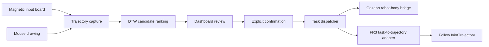

# Magnetic Trajectory Robot Interface

English | [简体中文](README.zh-CN.md)

> Public portfolio edition. Attribution, provenance, hardware-validation boundaries, and third-party license notices are kept below.

Magnetic Trajectory Robot Interface is a ROS1 robot interaction system with two control modes:

- `TASK`: a trajectory drawn on a magnetic board or with a mouse is ranked against a DTW template bank. The operator confirms one candidate. Only then does a task reach the robot.
- `TELEOP`: continuous Cartesian manual control through a shared C++ core with damped-least-squares inverse kinematics.

Both modes run against a Gazebo Panda simulation or a Franka FR3 controller path.

## Demo (Gazebo)

`TASK`: a mouse-drawn `2` is recognized, confirmed on the `C` dwell button,
and the robot-body bridge runs the mapped hexagon motion.


`TELEOP`: keyboard Cartesian control with the Gazebo gripper picks up a 5 cm
cube and places it on the green pad.


Both clips are real-time screen recordings of headless Docker Gazebo. Mouse and
key input is scripted with `xdotool`; the pick-and-place script releases each
key from the measured flange position. Recorded at `cef908c` (`TASK`, with
`visible_bridge_motion_scale:=3.0 visible_bridge_motion_duration_sec:=4.0`)
and `35df0ec` (`TELEOP`, `spawn_pick_objects:=true`, recorded with the scripts in
[scripts/demo](scripts/demo/README.md)). Not real-hardware footage.

## Architecture at a glance



Recognition never sends motion. Candidate display, confirmation, dispatch, and execution are separate steps. See [Architecture](docs/ARCHITECTURE.md) for components, topics, and backend separation.

## Control modes

| Backend | `TASK` | `TELEOP` |
| --- | --- | --- |
| Gazebo | Recognition-driven task execution | Keyboard Cartesian control and gripper |
| Real FR3 | Discrete task execution | Magnetic-board Cartesian teleoperation |

The system starts in `TASK`. The dashboard can request `TASK` or `TELEOP`. A mode request is not a hardware authorization: it does not start Gazebo, open serial, connect an FR3, load a controller, approve calibration, or enable physical commands.

Runtime evidence differs by route:

- Gazebo `TELEOP` ran at runtime: keyboard input, the shared `Fr3CartesianTeleopCore`, the simulated trajectory controller, a moving Gazebo Panda, and a keyboard pick-and-place with the simulated gripper. The CI job `gazebo-smoke` repeats mode gating, Cartesian motion, and gripper open/close on every pull request.
- The Real-FR3 Cartesian and discrete adapters compile and are part of the launch graph. Physical Real-FR3 `TELEOP` was not run.

See [Dual-Mode Teleoperation](docs/DUAL_MODE_TELEOPERATION.md).

## Features

- **Two input profiles.** A serial magnetic board and a mouse share one dashboard. The Board profile uses a magnetic-orientation clutch, so cursor moves between the drawing area and the buttons are not recorded.
- **DTW recognition.** A tracked template bank ranks the symbols `1,2,3,V,O,X,A,C`. Confidence and margin gates reject unclear samples. The feature and bank helpers are ROS-free Python.
- **Explicit confirmation.** The dashboard shows ranked candidates and dwell feedback. A task needs an explicit `C Confirm`.
- **Dispatcher boundary.** Only the dispatcher maps a confirmed label to a task from a fixed vocabulary.
- **Separate backends.** A Gazebo robot-body bridge and an FR3 `FollowJointTrajectory` adapter, each with conservative defaults and its own gates.
- **Shared Cartesian core.** One C++ core serves keyboard control in Gazebo and magnetic-board control on the FR3.
- **Gazebo gripper.** `O`/`C` in the keyboard terminal open and close the simulated Panda hand through a bridge that accepts commands only in `TELEOP`. `spawn_pick_objects:=true` adds a cube and a place pad.
- **Packaging and tests.** Separate Docker profiles for Gazebo and FR3 with build-time revision labels. Static, unit, route-isolation, and C++ safety tests run in CI.

## Board and Mouse interaction profiles

| Concern | Board profile | Mouse profile |
| --- | --- | --- |
| Draw | Orientation clutch plus drawing zone | Mouse stroke in dashboard |
| Recognize | Explicit `B Recognize` | Automatic after stroke release |
| Confirm | Explicit `C Confirm` | Explicit `C Confirm` |
| Clear | `X Clear` | `X Clear` |
| Transfer suppression | Clutch disengagement | Not required |

See [Interaction Profiles](docs/INTERACTION_PROFILES.md).

## Recognition and explicit confirmation

The recognizer normalizes a completed trajectory, compares it with the tracked DTW bank, and publishes ranked candidates on `/colmag/symbol_candidates`. The dashboard publishes the chosen label on `/colmag/confirmed_label` only after explicit confirmation. The dispatcher is the only publisher of `/colmag/task_command`. Showing a candidate cannot run a task.

The tracked bank was built from user-handwritten mouse seeds. Each template keeps its provenance fields. See [Running](docs/RUNNING.md#dtw-template-bank) for the offline build and evaluation tools.

## Gazebo and FR3 backends

- **Gazebo `TASK`:** a simulation-only bridge builds bounded Panda joint trajectories and sends them through a `FollowJointTrajectory` action.
- **Gazebo `TELEOP`:** normalized keyboard input passes through `Fr3CartesianTeleopCore`, which publishes bounded `JointTrajectory` commands to the controller. A separate bridge sends `O`/`C` gripper commands to the simulated `franka_gripper` actions.
- **Real FR3 `TASK`:** a C++ adapter checks each accepted discrete command and builds a bounded trajectory for the standard controller.
- **Real FR3 `TELEOP`:** continuous magnetic-board position passes through the same Cartesian core and a separately gated controller adapter.

pytest starts none of these. The CI job `gazebo-smoke` starts only the Gazebo `TELEOP` profile, with headless Gazebo. Real-robot motion stays disabled until every environment, revision, network, controller, calibration, and physical safety gate passes. See [Hardware Boundaries](docs/HARDWARE_BOUNDARIES.md).

## Technology stack

| Layer | Technology |
| --- | --- |
| Middleware | ROS1 Noetic, catkin, `rospy`, `roscpp` |
| Recognition | Python, DTW, JSON template bank |
| Interface | Tk dashboard and ROS topics |
| Simulation | Gazebo, Panda model, `control_msgs/FollowJointTrajectory` |
| Hardware interface | C++, `franka_ros`, `libfranka`, joint trajectory controller |
| Packaging | Docker, Docker Compose, OCI revision labels |
| Validation | pytest, ruff, GitHub Actions, ROS-free C++ safety tests, catkin build |

## Repository layout

```text
colmag_ros/                ROS package
  scripts/                 ROS node entry points (dashboard, recognizer, dispatcher, ...)
  src/colmag_ros/          ROS-free Python modules, including the dashboard mixins
  src/*.cpp, include/      FR3 adapters, Cartesian core, and C++ safety helpers
  launch/, config/         Launch files, controller settings, DTW bank
colmag_gazebo_stub/        Gazebo robot-body bridge package
src/serial_mvp/            Serial packet parser and source abstraction
scripts/                   Offline DTW tools and guarded FR3 operator helpers
  ci/                      Gazebo runtime smoke test used by CI
  demo/                    Scripted recording of the README pick-and-place GIF
docker/                    Gazebo and FR3 build and runtime profiles
tests/                     pytest suite, headless dashboard harness, C++ tests
docs/                      Architecture, running, validation, and boundary docs
.github/workflows/         CI: pytest (with and without ROS), ruff, catkin build, Gazebo smoke
```

Internal ROS identifiers keep the original `colmag` namespace for compatibility. A few runtime identifiers keep their original milestone prefix (`m104…`) because other parts depend on them:

- the tracked DTW bank file that the launch defaults and the Docker image point at;
- the dispatcher mapping name `m104c4_8symbol_gazebo`;
- two ROS node names;
- the real-board sample record schema;
- the FR3 operator log directory under `outputs/`.

Apart from the bank file, no file or module name carries a milestone prefix.

## Quick start

Install the test dependencies and run the suite without a pytest cache:

```bash
python3 -m pip install -r requirements.txt
python3 -m pytest -p no:cacheprovider -q
```

ROS Noetic is not needed. Tests that import ROS packages skip themselves without it.

Build the Mouse-to-Gazebo image from the current revision:

```bash
COLMAG_GIT_SHA="$(git rev-parse HEAD)" \
docker compose -f docker/compose.yaml \
  --profile mouse-gazebo build mouse-gazebo
```

Start the simulation only when GUI and Gazebo runtime are authorized:

```bash
docker/run_gazebo_demo.sh mouse-gazebo
```

The FR3 profiles are not part of the quick start. Read [Running](docs/RUNNING.md) before using any serial, simulation, or hardware surface.

## Validation

CI runs on every pull request and every push to `main`:

- `ruff check`;
- pytest with Python 3.10 without ROS;
- pytest in a ROS Noetic container, then a parse of the launch files that need no Gazebo or FR3 packages;
- a `catkin_make install` build of both ROS packages;
- a Gazebo smoke test: the image is built, the keyboard `TELEOP` profile runs with headless Gazebo, and a script checks mode gating, Cartesian motion, and gripper open/close.

The suite checks:

- Python static and unit contracts, and the ROS-free C++ safety helpers;
- Markdown and image links with case-sensitive paths;
- Docker image, Compose profile, and launcher contracts;
- launch file XML, route isolation, and install lists;
- that generated `outputs/` files are not tracked.

At export, the portfolio edition was also checked by hand for secrets, private network values, personal absolute paths, identity-bearing files, nontechnical process material, and misleading sole-authorship wording. CI does not repeat those checks.

See [Validation](docs/VALIDATION.md) for the commands, the CI jobs, and what each layer does not prove.

## Known limitations

- This is a research and demo stack, not a certified robot product.
- DTW quality depends on trajectory quality and template coverage.
- The Board orientation clutch is an application convention, not a safety-rated sensor mode.
- Static and unit tests do not prove live ROS timing, rendered GUI behavior, Gazebo motion, or physical FR3 safety.
- Gazebo Cartesian `TELEOP` has runtime evidence. Physical Real-FR3 Cartesian `TELEOP` does not.
- The gripper exists only in Gazebo. There is no Real-FR3 gripper route.
- The Gazebo smoke test checks one short scripted run. It does not cover the GUI, timing under load, or grasp quality.
- The FR3 route depends on specific upstream versions. Requalify it when the environment changes.

## My contribution

The fixed branch history, source ownership map, implementation files, and recorded validation evidence support the wording below.

| Area | Contribution |
| --- | --- |
| Interaction design | Designed and implemented the Board interaction clutch and the distinct Board/Mouse profiles. |
| Recognition integration | Implemented and integrated the DTW template-bank path, ranking gates, tracked bank, and evaluation tooling. |
| UI/dashboard | Implemented, refactored, and validated the shared dashboard, candidate display, dwell state, and explicit confirmation flow. |
| Execution integration | Integrated the dispatcher, Gazebo robot-body bridge, and FR3 task-to-trajectory adapter while preserving supervised execution boundaries. |
| Dual-mode teleoperation | Implemented and integrated `TASK`/`TELEOP` ownership, keyboard Cartesian Gazebo control, magnetic-board Real-FR3 integration, and the shared Cartesian core. |
| Docker/testing | Implemented Docker packaging and maintained static, unit, route-isolation, and safety validation. |
| Documentation | Authored and maintained architecture, operator, safety, and validation documentation for the fixed branch. |

These claims do not assert sole authorship of the original collaborative project or ownership of upstream ROS, Gazebo, Franka, or other third-party components.

## Attribution and provenance

This repository is a public personal portfolio edition derived from a collaborative robotics project. It focuses on the components I designed, integrated, validated, and documented. Collaborative and third-party contributions remain credited in [CREDITS.md](CREDITS.md), and the applicable notices are in [NOTICE.md](NOTICE.md).

The baseline was exported as a filtered tracked snapshot from source commit `e3c81fb31f5113c50f197bb11eff183295cf3163`. The dual-mode Cartesian teleoperation work, developed and validated after that commit, was added as a curated file export. The original Git history, branches, tags, internal process records, private evidence, and nontechnical materials were not copied. Later changes, such as refactoring, CI, and documentation, are recorded in this repository's own Git history.

## License and status

**Public portfolio edition.**

This repository adds no repository-wide license beyond the license information already in the retained source and package metadata. Public availability does not change third-party ownership or upstream license obligations. See [NOTICE.md](NOTICE.md) for provenance and dependency-license boundaries.
