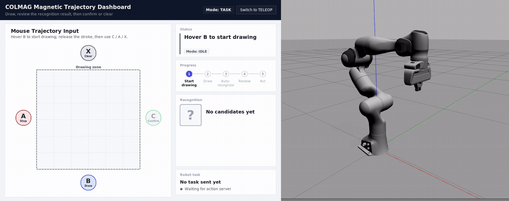
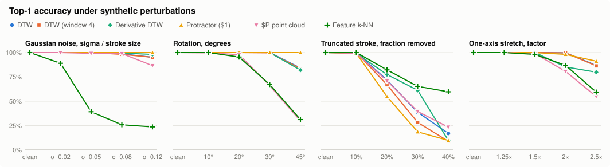
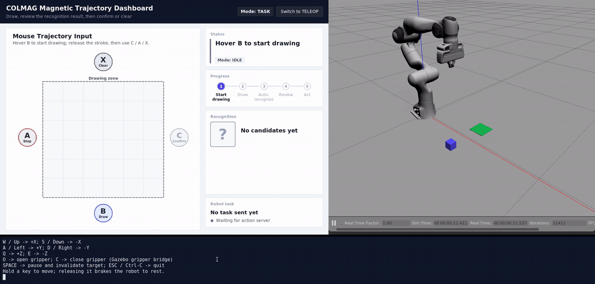
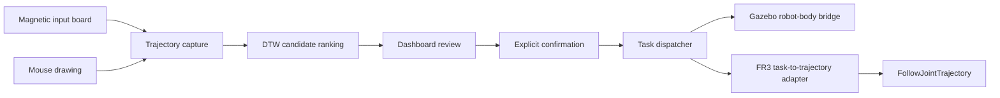

# Magnetic Trajectory Robot Interface

[](https://github.com/feizaodemon/magnetic-trajectory-robot-interface/actions/workflows/pytest.yml)

English | [简体中文](README.zh-CN.md)

Draw a symbol on a magnetic board or with the mouse. The system recognizes it with a DTW template bank, the operator confirms it on a dashboard, and only then does the robot run the matching task. A second mode drives the end effector directly through a C++ Cartesian teleoperation core. Built on ROS1 Noetic, running against a Gazebo Panda or a Franka FR3.



## Highlights

- **Gesture-to-task pipeline.** Pen or mouse strokes are normalized and ranked against a tracked DTW bank of 124 handwritten templates over 8 symbols (`1,2,3,V,O,X,A,C`). Leave-one-out Top-1 accuracy on that bank is 100% at about 83 ms per query ([Results](#results)). Confidence and margin gates reject unclear samples. Five alternative recognizers are benchmarked against it under synthetic noise, rotation and truncation ([Comparing recognizers](#comparing-recognizers)). The recognition code is plain Python with no ROS dependency.
- **Confirmation-gated command path.** Recognition, confirmation, dispatch and execution are separate ROS nodes. A candidate on screen cannot move the robot: only the dispatcher publishes `/colmag/task_command`, and only after an explicit `C Confirm`.
- **Shared Cartesian teleoperation core.** One C++ core (`Fr3CartesianTeleopCore`) turns keyboard or board input into bounded joint targets with damped-least-squares inverse kinematics. It drives both the Gazebo Panda and the Real-FR3 adapter.
- **Defensive hardware layer.** ROS-free C++ safety helpers (command replay guard, one-shot motion gate, ROS-time rollback guard, goal lifecycle tracking) sit in front of every FR3 trajectory and have their own unit tests.
- **Tested end to end in CI.** About 495 pytest cases plus C++ tests, ruff, mypy, a recognition-accuracy gate, a catkin build, and a headless Gazebo smoke test that checks mode gating, Cartesian motion and gripper open/close on every pull request.

## Results

| Measure | Result |
| --- | --- |
| Symbol recognition, leave-one-out over the 124 tracked templates (8 symbols) | Top-1 100%, Top-3 100% |
| Queries accepted by the runtime confidence and margin gates | 100%, all of them correct |
| Recognition time per query, pure-Python DTW against 123 templates | 83 ms median, 118 ms p95 on one CPU core |
| Automated checks | about 495 pytest tests, 7 ROS-free C++ test programs, 8 CI jobs |

All templates were drawn with a mouse by one person, so these numbers show that the 8 symbols separate cleanly within one writer's data. They are an upper bound, not a measured accuracy for new users or for the magnetic board. Reproduce them without ROS in about 10 seconds:

```bash
python3 scripts/eval_dtw_bank_loo.py
```

The CI job `dtw-eval` runs the same command on every pull request, puts the full report and confusion matrix in the job summary, and fails if Top-1 drops below 95%. Latency depends on the machine, so CI reports it without gating on it.

Recognition uses the full DTW search by default. An optional Sakoe-Chiba window (`dtw_template_window` in `dtw_template_bank_recognizer.launch`) trades exactness for speed. On the same leave-one-out run, a 4-point window is about 5.7x faster (21 ms instead of 121 ms median in one benchmark run) with Top-1 still 100%, but it reorders the 2nd and 3rd candidates on about half of the queries. `python3 scripts/bench_dtw_ranking.py` reproduces the table.

### Comparing recognizers

Because every method scores 100% on the clean bank, I also compared DTW with four other single-stroke recognizers (Derivative DTW, Protractor/$1, $P, and hand-crafted features with k-NN) on the same leave-one-out queries after seeded synthetic noise, rotation, early truncation and stretching.



| Recognizer | Noise σ=0.12 | Rotation 45° | Truncation 30% | Time per query |
| --- | --- | --- | --- | --- |
| DTW (runtime) | 95.2% | 84.1% | 38.7% | 89 ms |
| Protractor ($1) | 100.0% | 100.0% | 18.5% | 0.4 ms |
| Feature k-NN | 23.7% | 31.2% | 65.3% | 0.5 ms |

Protractor matches or beats DTW everywhere except truncated strokes, at about 1/200 of the cost. A stroke that ends early is the weak point of every shape matcher. The perturbations are synthetic and the data comes from one writer, so this ranks methods; it does not measure board accuracy. Full tables, method notes and limits: [Recognizer comparison](docs/RECOGNIZER_COMPARISON.md).

## Demo (Gazebo)

`TASK` (above): a mouse-drawn `2` is recognized and confirmed on the `C` dwell button, and the robot-body bridge runs the mapped hexagon motion.

`TELEOP`: keyboard Cartesian control and the Gazebo gripper pick up a 5 cm cube and put it on the green pad.



Both clips are real-time captures of headless Gazebo in Docker with scripted `xdotool` input; they are simulation, not hardware footage. The pick-and-place recording scripts are in [scripts/demo](scripts/demo/README.md).

## How it works



The recognizer normalizes the finished trajectory, compares it with the DTW bank, and publishes ranked candidates on `/colmag/symbol_candidates`. The dashboard publishes `/colmag/confirmed_label` only after `C Confirm`. The dispatcher maps labels to a fixed task vocabulary and is the only publisher of `/colmag/task_command`. See [Architecture](docs/ARCHITECTURE.md) for components and topics, and [Running](docs/RUNNING.md#dtw-template-bank) for the offline bank tools.

### Two modes, two backends

| | `TASK`: recognized symbol runs a task | `TELEOP`: continuous Cartesian control |
| --- | --- | --- |
| **Gazebo** | Simulation bridge sends bounded Panda trajectories through `FollowJointTrajectory` | Keyboard input through the Cartesian core, plus the simulated gripper (`O`/`C`) |
| **Real FR3** | C++ adapter checks each discrete command and builds a bounded trajectory | Board position through the same Cartesian core and a separately gated adapter |

The system starts in `TASK`; the dashboard switches modes. A mode switch only changes which mode owns the command path. It never starts a backend, connects to hardware or enables physical commands. Details: [Dual-Mode Teleoperation](docs/DUAL_MODE_TELEOPERATION.md), [Hardware Boundaries](docs/HARDWARE_BOUNDARIES.md).

### Board and mouse

The serial magnetic board and the mouse share one dashboard. On the board, a magnetic-orientation clutch decides when the pen is drawing, so moving between the drawing area and the buttons is not recorded. With the mouse, recognition runs automatically when the stroke ends. See [Interaction Profiles](docs/INTERACTION_PROFILES.md).

## Quick start

Run the tests. ROS Noetic is not needed; tests that import ROS packages skip themselves.

```bash
python3 -m pip install -r requirements.txt
python3 -m pytest -p no:cacheprovider -q
```

Build and start the Mouse-to-Gazebo demo (opens the Gazebo and dashboard windows):

```bash
COLMAG_GIT_SHA="$(git rev-parse HEAD)" \
docker compose -f docker/compose.yaml \
  --profile mouse-gazebo build mouse-gazebo
docker/run_gazebo_demo.sh mouse-gazebo
```

Read [Running](docs/RUNNING.md) before using the serial board or the FR3 profiles.

## Technology stack

| Layer | Technology |
| --- | --- |
| Middleware | ROS1 Noetic, catkin, `rospy`, `roscpp` |
| Recognition | Python, DTW, JSON template bank |
| Interface | Tk dashboard and ROS topics |
| Simulation | Gazebo, Panda model, `control_msgs/FollowJointTrajectory` |
| Hardware interface | C++, `franka_ros`, `libfranka`, joint trajectory controller |
| Packaging | Docker, Docker Compose, OCI revision labels |
| Validation | pytest, ruff, GitHub Actions, ROS-free C++ safety tests, catkin build |

## Repository layout

```text
colmag_ros/                ROS package
  scripts/                 ROS node entry points (dashboard, recognizer, dispatcher, ...)
  src/colmag_ros/          ROS-free Python modules, including the dashboard mixins
  src/*.cpp, include/      FR3 adapters, Cartesian core, and C++ safety helpers
  launch/, config/         Launch files, controller settings, DTW bank
colmag_gazebo_stub/        Gazebo robot-body bridge package
src/serial_mvp/            Serial packet parser and source abstraction
scripts/                   Offline DTW tools and guarded FR3 operator helpers
  ci/                      Gazebo runtime smoke test used by CI
  demo/                    Scripted recording of the pick-and-place GIF
docker/                    Gazebo and FR3 build and runtime profiles
tests/                     pytest suite, headless dashboard harness, C++ tests
docs/                      Architecture, running, validation, recognizer comparison, and boundary docs
.github/workflows/         CI: pytest (with and without ROS), ruff, mypy, DTW evaluation, catkin build, Gazebo smoke
```

## Testing and CI

Every pull request and push to `main` runs seven jobs:

- `ruff check`;
- `mypy` on the core ROS-free recognition and trajectory modules listed in `mypy.ini`;
- pytest on Python 3.10 without ROS;
- pytest in a ROS Noetic container, plus a parse of the launch files that need no Gazebo or FR3 packages;
- `catkin_make install` for both ROS packages;
- the Gazebo smoke test: build the image, run the keyboard `TELEOP` profile headless, and check mode gating, Cartesian motion and gripper open/close;
- the leave-one-out evaluation of the DTW bank, which fails below 95% Top-1.

The suite covers Python unit and static contracts, the C++ safety helpers, launch-file XML and route isolation, Docker profiles, and Markdown link integrity. [Validation](docs/VALIDATION.md) lists the commands and what each layer does not prove.

## My contribution

This repository is my portfolio copy of a collaborative project. My parts:

| Area | Contribution |
| --- | --- |
| Interaction design | Designed and implemented the board orientation clutch and the separate board and mouse profiles. |
| Recognition | Implemented and integrated the DTW template-bank path, ranking gates, tracked bank, and evaluation tooling. |
| Dashboard | Implemented, refactored and validated the shared dashboard, candidate display, dwell state, and confirmation flow. |
| Execution | Integrated the dispatcher, Gazebo robot-body bridge, and FR3 task-to-trajectory adapter within supervised execution boundaries. |
| Dual-mode teleoperation | Implemented `TASK`/`TELEOP` ownership, keyboard Cartesian control in Gazebo, the Real-FR3 board integration, and the shared Cartesian core. |
| Docker and testing | Built the Docker packaging, CI, and the static, unit, route-isolation and safety tests. |
| Documentation | Wrote the architecture, operator, safety and validation docs. |

## Limitations

- Research and demo stack, not a certified robot product. The board clutch is an application convention, not a safety-rated sensor.
- Gazebo `TELEOP` has run end to end and is rechecked in CI. The Real-FR3 adapters compile and are in the launch graph, but physical Real-FR3 `TELEOP` has not been run, and there is no Real-FR3 gripper route.
- DTW quality depends on trajectory quality and template coverage; the tracked bank was built from one person's mouse-drawn seeds, so the [Results](#results) do not measure other writers or the board.
- The Gazebo smoke test is one short scripted run. It does not cover the GUI, timing under load, or grasp quality.

## Provenance and license

This repository comes from a collaborative robotics project and contains the parts I designed, integrated, validated and documented. It does not claim sole authorship of the original project or ownership of upstream ROS, Gazebo, Franka or other third-party components. [CREDITS.md](CREDITS.md) credits collaborators; [NOTICE.md](NOTICE.md) covers provenance (baseline source commit `e3c81fb`), dependency licenses, and why no repository-wide license is added.

ROS identifiers keep the original `colmag` namespace, and a few runtime identifiers (the tracked bank file, one dispatcher mapping, two node names, a record schema, a log directory) keep the old `m104…` milestone prefix because launch files, Docker images and tests depend on them.
