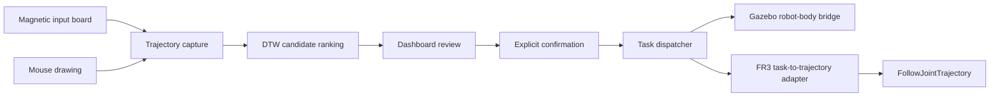

# Magnetic Trajectory Robot Interface（磁性轨迹机器人交互接口）

[English](README.md) | 简体中文

> 公开作品集版本。署名、来源、硬件验证边界和第三方许可说明见下文。本文是 [README.md](README.md) 的中文版；两者不一致时以英文版为准。

Magnetic Trajectory Robot Interface 是一个基于 ROS1 的机器人交互系统，有两种控制模式：

- `TASK`：在磁性画板上或用鼠标画出一条轨迹，系统用 DTW 模板库对它排序。操作者确认一个候选结果后，任务才会发送给机器人。
- `TELEOP`：连续笛卡尔手动控制。输入经过一个共享的 C++ 核心，核心用阻尼最小二乘（DLS）逆运动学求解关节目标。

两种模式都可以接 Gazebo Panda 仿真，或 Franka FR3 控制器路径。

## 演示（Gazebo）

`TASK`：鼠标画出 `2`，系统识别后在 `C` 停留按钮上确认，robot-body bridge 执行对应的六边形动作。


`TELEOP`：用键盘笛卡尔控制和 Gazebo 夹爪，夹起一个 5 cm 方块，放到绿色垫板上。


两段视频都是 headless Docker Gazebo 的实时录屏。鼠标和键盘输入由 `xdotool` 脚本产生；夹取放置脚本根据测得的法兰位置决定何时松键。录制时的版本见英文 README 的说明。这些不是真机画面。录制脚本在 [scripts/demo](scripts/demo/README.md)。

## 架构概览



识别结果本身不会产生任何运动。候选显示、确认、分发和执行是彼此独立的步骤。组件、topic 和后端隔离的细节见 [Architecture](docs/ARCHITECTURE.md)。

## 控制模式

| 后端 | `TASK` | `TELEOP` |
| --- | --- | --- |
| Gazebo | 识别驱动的任务执行 | 键盘笛卡尔控制和夹爪 |
| 真机 FR3 | 离散任务执行 | 磁性画板笛卡尔遥操作 |

系统启动时处于 `TASK`。dashboard 可以请求切换到 `TASK` 或 `TELEOP`。模式请求不等于硬件授权：它不会启动 Gazebo、打开串口、连接 FR3、加载控制器、批准标定，也不会开启物理指令。

各条路径的运行证据不同：

- Gazebo `TELEOP` 实际运行过：键盘输入、共享的 `Fr3CartesianTeleopCore`、仿真轨迹控制器、运动的 Gazebo Panda，以及带仿真夹爪的键盘夹取放置。CI job `gazebo-smoke` 在每个 pull request 上重复检查模式门控、笛卡尔运动和夹爪开合。
- 真机 FR3 的笛卡尔 adapter 和离散 adapter 能编译，并且在 launch 图中。真机 FR3 `TELEOP` 没有实际运行过。

详见 [Dual-Mode Teleoperation](docs/DUAL_MODE_TELEOPERATION.md)。

## 功能

- **两种输入方式。** 串口磁性画板和鼠标共用一个 dashboard。画板方式使用磁性朝向离合：光标在绘图区和按钮之间移动时不会被记录。
- **DTW 识别。** 一个受版本管理的模板库对符号 `1,2,3,V,O,X,A,C` 排序。置信度和间隔门限会拒绝不清晰的样本。特征和模板库工具是不依赖 ROS 的 Python。
- **显式确认。** dashboard 显示排序后的候选和停留进度。任务必须经过显式的 `C Confirm`。
- **分发边界。** 只有 dispatcher 能把确认后的标签映射成固定词表中的任务。
- **后端隔离。** Gazebo robot-body bridge 和 FR3 `FollowJointTrajectory` adapter 各自有保守的默认值和独立的门控。
- **共享笛卡尔核心。** 同一个 C++ 核心既服务 Gazebo 中的键盘控制，也服务 FR3 上的磁性画板控制。
- **Gazebo 夹爪。** 在键盘终端按 `O`/`C` 打开或闭合仿真 Panda 手爪。夹爪 bridge 只在 `TELEOP` 下接受指令。`spawn_pick_objects:=true` 会额外生成一个方块和一个放置垫板。
- **打包和测试。** Gazebo 和 FR3 各有独立的 Docker profile，镜像带构建时的 revision 标签。静态测试、单元测试、路径隔离测试和 C++ 安全测试都在 CI 中运行。

## 画板与鼠标两种交互方式

| 关注点 | 画板方式 | 鼠标方式 |
| --- | --- | --- |
| 绘制 | 朝向离合加绘图区 | 在 dashboard 中用鼠标画 |
| 识别 | 显式 `B Recognize` | 松开笔画后自动识别 |
| 确认 | 显式 `C Confirm` | 显式 `C Confirm` |
| 清除 | `X Clear` | `X Clear` |
| 移动时不记录 | 离合断开 | 不需要 |

详见 [Interaction Profiles](docs/INTERACTION_PROFILES.md)。

## 识别与显式确认

识别器把一条完成的轨迹归一化，与 DTW 模板库比较，然后在 `/colmag/symbol_candidates` 上发布排序后的候选。dashboard 只有在显式确认后，才会在 `/colmag/confirmed_label` 上发布选中的标签。dispatcher 是 `/colmag/task_command` 唯一的发布者。仅仅显示候选不会执行任务。

模板库由用户手写的鼠标样本构建，每个模板都保留来源字段。离线构建和评估工具见 [Running](docs/RUNNING.md#dtw-template-bank)。

## Gazebo 与 FR3 后端

- **Gazebo `TASK`：** 一个仅用于仿真的 bridge 生成有界的 Panda 关节轨迹，并通过 `FollowJointTrajectory` action 发送。
- **Gazebo `TELEOP`：** 归一化的键盘输入经过 `Fr3CartesianTeleopCore`，核心向控制器发布有界的 `JointTrajectory` 指令。另一个 bridge 把 `O`/`C` 夹爪指令转给仿真的 `franka_gripper` action。
- **真机 FR3 `TASK`：** 一个 C++ adapter 检查每条被接受的离散指令，为标准控制器生成有界轨迹。
- **真机 FR3 `TELEOP`：** 磁性画板的连续位置经过同一个笛卡尔核心，以及一个单独门控的控制器 adapter。

pytest 不会启动其中任何一个。CI job `gazebo-smoke` 只启动 Gazebo `TELEOP` profile，并使用 headless Gazebo。在环境、版本、网络、控制器、标定和物理安全门控全部通过之前，真机运动一直处于关闭状态。见 [Hardware Boundaries](docs/HARDWARE_BOUNDARIES.md)。

## 技术栈

| 层 | 技术 |
| --- | --- |
| 中间件 | ROS1 Noetic、catkin、`rospy`、`roscpp` |
| 识别 | Python、DTW、JSON 模板库 |
| 界面 | Tk dashboard 和 ROS topic |
| 仿真 | Gazebo、Panda 模型、`control_msgs/FollowJointTrajectory` |
| 硬件接口 | C++、`franka_ros`、`libfranka`、关节轨迹控制器 |
| 打包 | Docker、Docker Compose、OCI revision 标签 |
| 验证 | pytest、ruff、GitHub Actions、不依赖 ROS 的 C++ 安全测试、catkin 构建 |

## 仓库结构

```text
colmag_ros/                ROS 包
  scripts/                 ROS node 入口（dashboard、识别器、dispatcher 等）
  src/colmag_ros/          不依赖 ROS 的 Python 模块，包括 dashboard mixin
  src/*.cpp, include/      FR3 adapter、笛卡尔核心和 C++ 安全工具
  launch/, config/         launch 文件、控制器配置、DTW 模板库
colmag_gazebo_stub/        Gazebo robot-body bridge 包
src/serial_mvp/            串口数据包解析和数据源抽象
scripts/                   离线 DTW 工具和带门控的 FR3 操作脚本
  ci/                      CI 使用的 Gazebo 运行冒烟测试
  demo/                    README 夹取放置 GIF 的脚本化录制
docker/                    Gazebo 和 FR3 的构建与运行 profile
tests/                     pytest 测试集、headless dashboard harness、C++ 测试
docs/                      架构、运行、验证和边界文档
.github/workflows/         CI：pytest（有 ROS 和无 ROS）、ruff、catkin 构建、Gazebo 冒烟测试
```

为了兼容，内部 ROS 标识符保留原来的 `colmag` 命名空间。少数运行时标识符保留原来的里程碑前缀（`m104…`），因为其他部分依赖它们：

- launch 默认值和 Docker 镜像指向的受版本管理的 DTW 模板库文件；
- dispatcher 映射名 `m104c4_8symbol_gazebo`；
- 两个 ROS node 名；
- 真实画板样本记录的格式；
- `outputs/` 下的 FR3 操作日志目录。

除模板库文件外，没有文件或模块名带里程碑前缀。

## 快速开始

安装测试依赖，然后不使用 pytest 缓存运行测试集：

```bash
python3 -m pip install -r requirements.txt
python3 -m pytest -p no:cacheprovider -q
```

不需要 ROS Noetic。导入 ROS 包的测试在没有 ROS 时会自动跳过。

从当前版本构建鼠标到 Gazebo 的镜像：

```bash
COLMAG_GIT_SHA="$(git rev-parse HEAD)" \
docker compose -f docker/compose.yaml \
  --profile mouse-gazebo build mouse-gazebo
```

只有在允许运行 GUI 和 Gazebo 时才启动仿真：

```bash
docker/run_gazebo_demo.sh mouse-gazebo
```

FR3 profile 不属于快速开始。使用任何串口、仿真或硬件功能之前，请先阅读 [Running](docs/RUNNING.md)。

## 验证

CI 在每个 pull request 和每次推送到 `main` 时运行：

- `ruff check`；
- 无 ROS 的 Python 3.10 pytest；
- ROS Noetic 容器中的 pytest，然后解析不需要 Gazebo 或 FR3 包的 launch 文件；
- 两个 ROS 包的 `catkin_make install` 构建；
- Gazebo 冒烟测试：构建镜像，用 headless Gazebo 运行键盘 `TELEOP` profile，由脚本检查模式门控、笛卡尔运动和夹爪开合。

测试集检查：

- Python 静态和单元契约，以及不依赖 ROS 的 C++ 安全工具；
- Markdown 和图片链接（区分大小写的路径）；
- Docker 镜像、Compose profile 和启动脚本的契约；
- launch 文件 XML、路径隔离和安装列表；
- 生成的 `outputs/` 文件没有被纳入版本管理。

导出作品集版本时，还人工检查过密钥、私有网络地址、个人绝对路径、含身份信息的文件、非技术性过程材料，以及容易误导为独立作者的措辞。CI 不重复这些检查。

命令、CI job，以及每一层验证不能证明什么，见 [Validation](docs/VALIDATION.md)。

## 已知限制

- 这是研究和演示用的系统，不是经过认证的机器人产品。
- DTW 的效果取决于轨迹质量和模板覆盖范围。
- 画板朝向离合是应用层约定，不是安全等级的传感器模式。
- 静态测试和单元测试不能证明实时 ROS 时序、GUI 渲染效果、Gazebo 运动或真机 FR3 安全性。
- Gazebo 笛卡尔 `TELEOP` 有运行证据，真机 FR3 笛卡尔 `TELEOP` 没有。
- 夹爪只存在于 Gazebo 中，没有真机 FR3 夹爪路径。
- Gazebo 冒烟测试只检查一次简短的脚本化运行，不覆盖 GUI、负载下的时序或抓取质量。
- FR3 路径依赖特定的上游版本。环境变化时需要重新验证。

## 我的贡献

固定分支的历史、源码归属表、实现文件和已记录的验证证据支持以下表述。

| 领域 | 贡献 |
| --- | --- |
| 交互设计 | 设计并实现了画板交互离合，以及画板/鼠标两种独立的交互方式。 |
| 识别集成 | 实现并集成了 DTW 模板库路径、排序门限、受版本管理的模板库和评估工具。 |
| 界面/dashboard | 实现、重构并验证了共享 dashboard、候选显示、停留状态和显式确认流程。 |
| 执行集成 | 集成了 dispatcher、Gazebo robot-body bridge 和 FR3 任务到轨迹 adapter，并保持受监督执行的边界。 |
| 双模式遥操作 | 实现并集成了 `TASK`/`TELEOP` 控制权、Gazebo 键盘笛卡尔控制、真机 FR3 磁性画板集成，以及共享笛卡尔核心。 |
| Docker/测试 | 实现了 Docker 打包，并维护静态、单元、路径隔离和安全验证。 |
| 文档 | 编写并维护了固定分支的架构、操作、安全和验证文档。 |

以上表述不声称是原协作项目的唯一作者，也不声称拥有上游 ROS、Gazebo、Franka 或其他第三方组件。

## 署名与来源

本仓库是从一个协作机器人项目派生出的公开个人作品集版本，重点展示我设计、集成、验证和编写文档的部分。协作者和第三方的贡献记录在 [CREDITS.md](CREDITS.md) 中，适用的声明见 [NOTICE.md](NOTICE.md)。

基线是从源 commit `e3c81fb31f5113c50f197bb11eff183295cf3163` 导出的经过筛选的快照。在该 commit 之后开发并验证的双模式笛卡尔遥操作工作，以精选文件的形式加入。原 Git 历史、分支、tag、内部过程记录、私有证据和非技术材料没有被复制。之后的修改（如重构、CI 和文档）记录在本仓库自己的 Git 历史中。

## 许可与状态

**公开作品集版本。**

除保留的源码和包元数据中已有的许可信息外，本仓库不添加任何仓库级许可。公开发布不改变第三方的所有权，也不改变上游许可义务。来源和依赖许可边界见 [NOTICE.md](NOTICE.md)。
