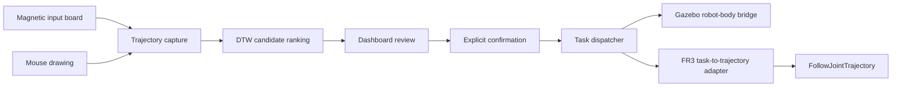

# Magnetic Trajectory Robot Interface

[English](README.md) | 简体中文

在磁性画板上或用鼠标画一个符号。系统识别出来，你确认之后，机器人执行对应的任务。另一种模式可以直接控制末端移动。系统基于 ROS1 Noetic，可以接 Gazebo 里的 Panda，也可以接 Franka FR3。

这是一个协作项目的个人作品集版本。我做了哪些部分、其他贡献者是谁、哪些在真机上验证过、哪些没有，都写在文末。中英文内容不一致时，以 [英文版](README.md) 为准。

## 演示（Gazebo）

`TASK`：用鼠标画一个 `2`，系统识别后，在 `C` 停留按钮上确认。随后 robot-body bridge 执行对应的六边形动作。


`TELEOP`：用键盘笛卡尔控制和 Gazebo 夹爪，把一个 5 cm 方块夹到绿色垫板上。


两段都是 Docker 里 headless Gazebo 的实时录屏，不是真机画面。鼠标和键盘输入由 `xdotool` 脚本产生。夹取放置时，脚本根据测得的法兰位置决定何时松开按键。`TASK` 录制于 `cef908c`，参数为 `visible_bridge_motion_scale:=3.0 visible_bridge_motion_duration_sec:=4.0`。`TELEOP` 录制于 `35df0ec`，参数为 `spawn_pick_objects:=true`，使用 [scripts/demo](scripts/demo/README.md) 中的脚本。

## 两种模式

- `TASK`：把画出的轨迹和 DTW 模板库比较，显示排在前面的候选结果。操作者确认其中一个之前，机器人不会收到任何指令。
- `TELEOP`：连续笛卡尔控制。共享的 C++ 核心用阻尼最小二乘（DLS）逆运动学，把输入换算成关节目标。

| 后端 | `TASK` | `TELEOP` |
| --- | --- | --- |
| Gazebo | 识别出的符号触发任务 | 键盘笛卡尔控制和夹爪 |
| 真机 FR3 | 离散任务 | 磁性画板笛卡尔控制 |

系统启动时处于 `TASK`，在 dashboard 上切换模式。切换模式只改变由哪个模式控制指令通路。它不会启动 Gazebo、打开串口、连接 FR3、加载控制器、批准标定，也不会开启物理指令。

各条路径的验证情况：

- Gazebo `TELEOP` 完整运行过：键盘输入、`Fr3CartesianTeleopCore`、仿真轨迹控制器、Panda 实际运动，以及用仿真夹爪完成的夹取放置。每个 pull request 都会运行 CI job `gazebo-smoke`，重新检查模式门控、笛卡尔运动和夹爪开合。
- 真机 FR3 的笛卡尔 adapter 和离散 adapter 能编译，也在 launch 图里。但真机 FR3 `TELEOP` 从未实际运行过。

详见 [Dual-Mode Teleoperation](docs/DUAL_MODE_TELEOPERATION.md)。

## 从画符号到机器人运动



识别器先把画完的轨迹归一化，再与 DTW 模板库比较，然后在 `/colmag/symbol_candidates` 上发布排序后的候选。置信度和间隔门限会拒绝不清楚的样本。只有按下 `C Confirm` 后，dashboard 才在 `/colmag/confirmed_label` 上发布标签。dispatcher 是 `/colmag/task_command` 唯一的发布者，只把标签映射到固定的任务词表。因此，屏幕上显示的候选本身不能触发运动。识别、确认、分发和执行是分开的步骤。组件和 topic 见 [Architecture](docs/ARCHITECTURE.md)。

受版本管理的模板库包含 `1,2,3,V,O,X,A,C` 八个符号，由用户手写的鼠标样本构建，每个模板都保留来源字段。特征和模板库代码是纯 Python，不依赖 ROS。离线构建和评估工具见 [Running](docs/RUNNING.md#dtw-template-bank)。

## 画板和鼠标

串口磁性画板和鼠标共用一个 dashboard。画板上有一个磁性朝向离合，用来判断笔是否在绘制。因此笔在绘图区和按钮之间移动时，不会被记录。

| | 画板 | 鼠标 |
| --- | --- | --- |
| 绘制 | 朝向离合加绘图区 | 在 dashboard 里用鼠标画 |
| 识别 | `B Recognize` | 笔画结束后自动识别 |
| 确认 | `C Confirm` | `C Confirm` |
| 清除 | `X Clear` | `X Clear` |
| 在区域间移动 | 离合断开，不记录 | 不存在这个问题 |

详见 [Interaction Profiles](docs/INTERACTION_PROFILES.md)。

## 后端

- Gazebo `TASK`：一个只用于仿真的 bridge 生成有界的 Panda 关节轨迹，并通过 `FollowJointTrajectory` action 发送。
- Gazebo `TELEOP`：键盘输入经过 `Fr3CartesianTeleopCore`，由它向控制器发布有界的 `JointTrajectory` 指令。在键盘终端按 `O`/`C` 可以打开或闭合仿真 Panda 手爪。这两个指令经过一个单独的 bridge 发给 `franka_gripper` action。这个 bridge 只在 `TELEOP` 下接受指令。`spawn_pick_objects:=true` 会额外生成一个方块和一个放置垫板。
- 真机 FR3 `TASK`：一个 C++ adapter 检查每条被接受的离散指令，为标准控制器生成有界轨迹。
- 真机 FR3 `TELEOP`：画板的位置经过同一个笛卡尔核心，再经过一个单独门控的控制器 adapter。

每个后端都有保守的默认值和自己的门控。pytest 不会启动任何后端。`gazebo-smoke` 只启动 Gazebo `TELEOP` profile，并使用 headless Gazebo。在环境、版本、网络、控制器、标定和物理安全门控全部通过之前，真机运动保持关闭。见 [Hardware Boundaries](docs/HARDWARE_BOUNDARIES.md)。

## 技术栈

| 层 | 技术 |
| --- | --- |
| 中间件 | ROS1 Noetic、catkin、`rospy`、`roscpp` |
| 识别 | Python、DTW、JSON 模板库 |
| 界面 | Tk dashboard 和 ROS topic |
| 仿真 | Gazebo、Panda 模型、`control_msgs/FollowJointTrajectory` |
| 硬件接口 | C++、`franka_ros`、`libfranka`、关节轨迹控制器 |
| 打包 | Docker、Docker Compose、OCI revision 标签 |
| 验证 | pytest、ruff、GitHub Actions、不依赖 ROS 的 C++ 安全测试、catkin 构建 |

## 仓库结构

```text
colmag_ros/                ROS 包
  scripts/                 ROS node 入口（dashboard、识别器、dispatcher 等）
  src/colmag_ros/          不依赖 ROS 的 Python 模块，包括 dashboard mixin
  src/*.cpp, include/      FR3 adapter、笛卡尔核心和 C++ 安全工具
  launch/, config/         launch 文件、控制器配置、DTW 模板库
colmag_gazebo_stub/        Gazebo robot-body bridge 包
src/serial_mvp/            串口数据包解析和数据源抽象
scripts/                   离线 DTW 工具和带门控的 FR3 操作脚本
  ci/                      CI 使用的 Gazebo 运行冒烟测试
  demo/                    夹取放置 GIF 的脚本化录制
docker/                    Gazebo 和 FR3 的构建与运行 profile
tests/                     pytest 测试集、headless dashboard harness、C++ 测试
docs/                      架构、运行、验证和边界文档
.github/workflows/         CI：pytest（有 ROS 和无 ROS）、ruff、catkin 构建、Gazebo 冒烟测试
```

ROS 标识符保留了原来的 `colmag` 命名空间。另有少数运行时标识符保留了旧的里程碑前缀（`m104…`），因为其他部分依赖它们：

- launch 默认值和 Docker 镜像指向的模板库文件；
- dispatcher 映射名 `m104c4_8symbol_gazebo`；
- 两个 ROS node 名；
- 真实画板样本记录的格式；
- `outputs/` 下的 FR3 操作日志目录。

除模板库文件外，没有文件名或模块名带这个前缀。

## 快速开始

运行测试。不需要 ROS Noetic，没有 ROS 时，依赖 ROS 包的测试会自动跳过。

```bash
python3 -m pip install -r requirements.txt
python3 -m pytest -p no:cacheprovider -q
```

从当前版本构建鼠标到 Gazebo 的镜像：

```bash
COLMAG_GIT_SHA="$(git rev-parse HEAD)" \
docker compose -f docker/compose.yaml \
  --profile mouse-gazebo build mouse-gazebo
```

启动仿真。这会打开 Gazebo 和 dashboard 窗口。

```bash
docker/run_gazebo_demo.sh mouse-gazebo
```

这里不包括 FR3 profile。使用串口画板、仿真或硬件之前，请先读 [Running](docs/RUNNING.md)。

## 验证

CI 在每个 pull request 和每次推送到 `main` 时运行：

- `ruff check`；
- 无 ROS 的 Python 3.10 pytest；
- ROS Noetic 容器里的 pytest，然后解析不需要 Gazebo 或 FR3 包的 launch 文件；
- 两个 ROS 包的 `catkin_make install`；
- Gazebo 冒烟测试：构建镜像，用 headless Gazebo 运行键盘 `TELEOP` profile，检查模式门控、笛卡尔运动和夹爪开合。

测试覆盖：

- Python 静态和单元契约，以及不依赖 ROS 的 C++ 安全工具；
- Markdown 和图片链接（路径区分大小写）；
- Docker 镜像、Compose profile 和启动脚本；
- launch 文件 XML、路径隔离和安装列表；
- 生成的 `outputs/` 文件没有被纳入版本管理。

导出时，我人工检查了这个版本有没有密钥、私有网络地址、个人绝对路径、带身份信息的文件、非技术性的过程材料，以及会让人误以为是独立作者的措辞。CI 不重复这些检查。

[Validation](docs/VALIDATION.md) 列出了具体命令和 CI job，也说明了每一层验证不能证明什么。

## 已知限制

- 这是研究和演示用的系统，不是经过认证的机器人产品。
- DTW 的效果取决于轨迹质量和模板覆盖范围。
- 画板的朝向离合是应用层约定，不是安全等级的传感器模式。
- 静态测试和单元测试不能说明实时 ROS 时序、GUI 渲染、Gazebo 运动或真机 FR3 的安全性。
- Gazebo 笛卡尔 `TELEOP` 有运行证据，真机 FR3 笛卡尔 `TELEOP` 没有。
- 夹爪只在 Gazebo 里有，没有真机 FR3 夹爪路径。
- Gazebo 冒烟测试只是一次简短的脚本化运行，不覆盖 GUI、负载下的时序和抓取质量。
- FR3 路径依赖特定的上游版本，环境变化后需要重新验证。

## 我的贡献

下表中的每一项，都有固定分支的历史、源码归属表、实现文件和已记录的验证证据作为依据。

| 领域 | 贡献 |
| --- | --- |
| 交互设计 | 设计并实现了画板交互离合，以及画板/鼠标两种独立的交互方式。 |
| 识别集成 | 实现并集成了 DTW 模板库路径、排序门限、受版本管理的模板库和评估工具。 |
| 界面/dashboard | 实现、重构并验证了共享 dashboard、候选显示、停留状态和显式确认流程。 |
| 执行集成 | 集成了 dispatcher、Gazebo robot-body bridge 和 FR3 任务到轨迹 adapter，并保持受监督执行的边界。 |
| 双模式遥操作 | 实现并集成了 `TASK`/`TELEOP` 控制权、Gazebo 键盘笛卡尔控制、真机 FR3 磁性画板集成，以及共享笛卡尔核心。 |
| Docker/测试 | 实现了 Docker 打包，并维护静态、单元、路径隔离和安全验证。 |
| 文档 | 编写并维护了固定分支的架构、操作、安全和验证文档。 |

以上表述不声称是原协作项目的唯一作者，也不声称拥有上游 ROS、Gazebo、Franka 或其他第三方组件。

## 署名与来源

本仓库来自一个协作机器人项目，只包含我设计、集成、验证和编写文档的部分。协作者和第三方的贡献记录在 [CREDITS.md](CREDITS.md)，适用的声明见 [NOTICE.md](NOTICE.md)。

基线是源 commit `e3c81fb31f5113c50f197bb11eff183295cf3163` 中受版本管理文件的筛选快照。双模式笛卡尔遥操作是在这个 commit 之后开发并验证的，后来以精选文件的形式加入。原 Git 历史、分支、tag、内部过程记录、私有证据和非技术材料都没有复制过来。之后的重构、CI、文档等修改，记录在本仓库自己的 Git 历史里。

## 许可

本仓库没有添加仓库级许可，许可信息只有保留的源码和包元数据中原有的那些。公开发布不改变第三方的所有权，也不改变上游许可义务。来源和依赖许可见 [NOTICE.md](NOTICE.md)。
