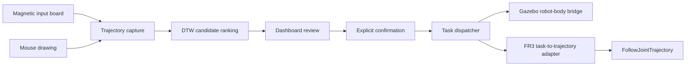

# Magnetic Trajectory Robot Interface

[](https://github.com/feizaodemon/magnetic-trajectory-robot-interface/actions/workflows/pytest.yml)

[English](README.md) | 简体中文

在磁性画板上或用鼠标画一个符号。系统用 DTW 模板库识别，操作者在 dashboard 上确认之后，机器人才执行对应的任务。另一种模式通过 C++ 笛卡尔遥操作核心直接控制末端。系统基于 ROS1 Noetic，可以接 Gazebo 里的 Panda，也可以接 Franka FR3。中英文内容不一致时，以 [英文版](README.md) 为准。


**在浏览器里试识别器：** [feizaodemon.github.io/magnetic-trajectory-robot-interface/](https://feizaodemon.github.io/magnetic-trajectory-robot-interface/)。画八个符号中的任意一个，就能看到和机器人端相同的 DTW 排序和接受门限，用的也是同一份模板库。全部在网页里运行，不会让任何机器人动。源码：[web/recognizer](web/recognizer/README.md)。

## 亮点

- **从手势到任务的完整链路。** 画板或鼠标笔画经过归一化，与受版本管理的 DTW 模板库排序比较。模板库有 124 条手写模板，覆盖 8 个符号（`1,2,3,V,O,X,A,C`）。在这个模板库上做留一法，Top-1 准确率为 100%，每次查询约 83 ms（见[结果](#结果)）。置信度和间隔门限会拒绝不清楚的样本。另外还有五种识别方法在合成噪声、旋转和截断下与它做了对比（见[识别方法对比](#识别方法对比)）。识别代码是纯 Python，不依赖 ROS。
- **确认门控的指令通路。** 识别、确认、分发和执行是彼此独立的 ROS node。屏幕上的候选不能让机器人运动：只有 dispatcher 会发布 `/colmag/task_command`，并且必须先显式按下 `C Confirm`。
- **共享的笛卡尔遥操作核心。** 一个 C++ 核心（`Fr3CartesianTeleopCore`）用阻尼最小二乘（DLS）逆运动学，把键盘或画板输入换算成有界的关节目标，同时驱动 Gazebo Panda 和真机 FR3 adapter。
- **防御式硬件层。** 每条 FR3 轨迹前面都有不依赖 ROS 的 C++ 安全模块（指令重放保护、单次运动门、ROS 时间回退保护、goal 生命周期跟踪），并有独立的单元测试。
- **CI 端到端验证。** 约 495 个 pytest 用例加 C++ 测试、ruff、mypy、识别准确率门限、catkin 构建，以及一个 headless Gazebo 冒烟测试，每个 pull request 都会检查模式门控、笛卡尔运动和夹爪开合。

## 结果

| 指标 | 结果 |
| --- | --- |
| 符号识别：在已提交的 124 条模板（8 个符号）上做留一法 | Top-1 100%，Top-3 100% |
| 被运行时置信度和间隔门限接受的查询 | 100%，全部正确 |
| 每次识别耗时：纯 Python DTW，对比 123 条模板 | 中位数 83 ms，p95 118 ms（单个 CPU 核） |
| 自动化检查 | 约 495 个 pytest 测试、7 个不依赖 ROS 的 C++ 测试程序、8 个 CI job |

所有模板都是同一个人用鼠标画的，所以这些数字说明的是：在同一个人的数据里，8 个符号能被清楚地区分开。它们是上限，不是对新用户或磁性画板实测的准确率。不需要 ROS，大约 10 秒即可复现：

```bash
python3 scripts/eval_dtw_bank_loo.py
```

CI job `dtw-eval` 在每个 pull request 上运行同一条命令，把完整报告和混淆矩阵写进 job summary，Top-1 低于 95% 时失败。耗时取决于机器，所以 CI 只报告、不设门限。

识别默认使用完整的 DTW 搜索。可选的 Sakoe-Chiba 窗口（`dtw_template_bank_recognizer.launch` 中的 `dtw_template_window`）用精确性换速度。在同样的留一法测试里，4 点窗口快约 5.7 倍（一次基准测试中，中位数 21 ms，完整搜索为 121 ms），Top-1 仍是 100%，但大约一半的查询里第 2、3 名候选的顺序会变。运行 `python3 scripts/bench_dtw_ranking.py` 可复现这张表。

### 识别方法对比

在干净数据上所有方法都是 100%，拉不开差距，所以我在同样的留一法查询上加了带随机种子的合成扰动（噪声、旋转、提前截断、拉伸），把 DTW 和另外四种单笔画识别方法做了对比：Derivative DTW、Protractor（$1）、$P，以及手工特征加 k-NN。


| 识别方法 | 噪声 σ=0.12 | 旋转 45° | 截掉 30% | 每次查询耗时 |
| --- | --- | --- | --- | --- |
| DTW（运行时） | 95.2% | 84.1% | 38.7% | 89 ms |
| Protractor（$1） | 100.0% | 100.0% | 18.5% | 0.4 ms |
| 特征 k-NN | 23.7% | 31.2% | 65.3% | 0.5 ms |

除了笔画被截断的情况，Protractor 都不差于 DTW，而耗时只有 DTW 的约 1/200。笔画提前结束是所有形状匹配方法的共同弱点。扰动是合成的，数据也只来自一个人，所以这个对比只能给方法排序，不能代表画板上的准确率。完整表格、方法说明和局限见 [识别方法对比](docs/RECOGNIZER_COMPARISON.md)（英文）。

## 演示（Gazebo）

`TASK`（上图）：用鼠标画一个 `2`，系统识别后在 `C` 停留按钮上确认，robot-body bridge 执行对应的六边形动作。

`TELEOP`：用键盘笛卡尔控制和 Gazebo 夹爪，把一个 5 cm 方块夹到绿色垫板上。


两段都是 Docker 里 headless Gazebo 的实时录屏，输入由 `xdotool` 脚本产生；是仿真，不是真机画面。夹取放置的录制脚本在 [scripts/demo](scripts/demo/README.md)。

## 工作原理



识别器把画完的轨迹归一化，与 DTW 模板库比较，然后在 `/colmag/symbol_candidates` 上发布排序后的候选。只有按下 `C Confirm` 后，dashboard 才在 `/colmag/confirmed_label` 上发布标签。dispatcher 把标签映射到固定的任务词表，是 `/colmag/task_command` 唯一的发布者。组件和 topic 见 [Architecture](docs/ARCHITECTURE.md)，离线模板库工具见 [Running](docs/RUNNING.md#dtw-template-bank)。

设计取舍（每个决策的备选方案与权衡）见 [Design decisions](docs/DESIGN_DECISIONS.md)。

### 两种模式，两种后端

| | `TASK`：识别出的符号触发任务 | `TELEOP`：连续笛卡尔控制 |
| --- | --- | --- |
| **Gazebo** | 仿真 bridge 通过 `FollowJointTrajectory` 发送有界的 Panda 轨迹 | 键盘输入经过笛卡尔核心，并可用 `O`/`C` 控制仿真夹爪 |
| **真机 FR3** | C++ adapter 检查每条离散指令并生成有界轨迹 | 画板位置经过同一个笛卡尔核心和单独门控的 adapter |

系统启动时处于 `TASK`，在 dashboard 上切换模式。切换模式只改变由哪个模式控制指令通路，不会启动后端、连接硬件或开启物理指令。详见 [Dual-Mode Teleoperation](docs/DUAL_MODE_TELEOPERATION.md) 和 [Hardware Boundaries](docs/HARDWARE_BOUNDARIES.md)。

### 画板和鼠标

串口磁性画板和鼠标共用一个 dashboard。画板上有一个磁性朝向离合，用来判断笔是否在绘制，所以笔在绘图区和按钮之间移动时不会被记录。用鼠标时，笔画结束后自动识别。详见 [Interaction Profiles](docs/INTERACTION_PROFILES.md)。

## 快速开始

运行测试。不需要 ROS Noetic，依赖 ROS 包的测试会自动跳过。

```bash
python3 -m pip install -r requirements.txt
python3 -m pytest -p no:cacheprovider -q
```

构建并启动鼠标到 Gazebo 的演示（会打开 Gazebo 和 dashboard 窗口）：

```bash
COLMAG_GIT_SHA="$(git rev-parse HEAD)" \
docker compose -f docker/compose.yaml \
  --profile mouse-gazebo build mouse-gazebo
docker/run_gazebo_demo.sh mouse-gazebo
```

使用串口画板或 FR3 profile 之前，请先读 [Running](docs/RUNNING.md)。

## 技术栈

| 层 | 技术 |
| --- | --- |
| 中间件 | ROS1 Noetic、catkin、`rospy`、`roscpp` |
| 识别 | Python、DTW、JSON 模板库 |
| 界面 | Tk dashboard 和 ROS topic |
| 仿真 | Gazebo、Panda 模型、`control_msgs/FollowJointTrajectory` |
| 硬件接口 | C++、`franka_ros`、`libfranka`、关节轨迹控制器 |
| 打包 | Docker、Docker Compose、OCI revision 标签 |
| 验证 | pytest、ruff、GitHub Actions、不依赖 ROS 的 C++ 安全测试、catkin 构建 |

## 仓库结构

```text
colmag_ros/                ROS 包
  scripts/                 ROS node 入口（dashboard、识别器、dispatcher 等）
  src/colmag_ros/          不依赖 ROS 的 Python 模块，包括 dashboard mixin
  src/*.cpp, include/      FR3 adapter、笛卡尔核心和 C++ 安全工具
  launch/, config/         launch 文件、控制器配置、DTW 模板库
colmag_gazebo_stub/        Gazebo robot-body bridge 包
src/serial_mvp/            串口数据包解析和数据源抽象
scripts/                   离线 DTW 工具和带门控的 FR3 操作脚本
  ci/                      CI 使用的 Gazebo 运行冒烟测试
  demo/                    夹取放置 GIF 的脚本化录制
web/recognizer/            识别器的浏览器移植版（GitHub Pages 演示）
docker/                    Gazebo 和 FR3 的构建与运行 profile
tests/                     pytest 测试集、headless dashboard harness、C++ 测试
docs/                      架构、运行、验证、识别方法对比和边界文档
.github/workflows/         CI：pytest（有 ROS 和无 ROS）、ruff、mypy、DTW 评估、catkin 构建、Gazebo 冒烟测试
```

## 测试与 CI

每个 pull request 和每次推送到 `main` 都会运行七个 job：

- `ruff check`；
- `mypy` 检查 `mypy.ini` 中列出的核心无 ROS 识别和轨迹模块；
- 无 ROS 的 Python 3.10 pytest；
- ROS Noetic 容器里的 pytest，然后解析不需要 Gazebo 或 FR3 包的 launch 文件；
- 两个 ROS 包的 `catkin_make install`；
- Gazebo 冒烟测试：构建镜像，用 headless Gazebo 运行键盘 `TELEOP` profile，检查模式门控、笛卡尔运动和夹爪开合；
- DTW 模板库的留一法评估，Top-1 低于 95% 时失败。

另有一个 `recognizer demo` workflow 构建浏览器演示，并从 `main` 部署到 GitHub Pages。pytest job 还会检查 `web/recognizer` 里的 JavaScript 移植版和 Python 识别器给出相同的排序和门限判定。

测试覆盖 Python 单元和静态契约、C++ 安全模块、launch 文件 XML 和路径隔离、Docker profile，以及 Markdown 链接完整性。[Validation](docs/VALIDATION.md) 列出了具体命令，也说明了每一层验证不能证明什么。

## 我的贡献

本仓库是一个协作项目的个人作品集版本。我负责的部分：

| 领域 | 贡献 |
| --- | --- |
| 交互设计 | 设计并实现了画板朝向离合，以及画板/鼠标两种独立的交互方式。 |
| 识别 | 实现并集成了 DTW 模板库路径、排序门限、受版本管理的模板库和评估工具。 |
| Dashboard | 实现、重构并验证了共享 dashboard、候选显示、停留状态和确认流程。 |
| 执行 | 在受监督执行的边界内集成了 dispatcher、Gazebo robot-body bridge 和 FR3 任务到轨迹 adapter。 |
| 双模式遥操作 | 实现了 `TASK`/`TELEOP` 控制权、Gazebo 键盘笛卡尔控制、真机 FR3 画板集成，以及共享笛卡尔核心。 |
| Docker 与测试 | 搭建了 Docker 打包、CI，以及静态、单元、路径隔离和安全测试。 |
| 文档 | 编写了架构、操作、安全和验证文档。 |

## 局限

- 这是研究和演示用的系统，不是经过认证的机器人产品。画板朝向离合是应用层约定，不是安全等级的传感器。
- Gazebo `TELEOP` 完整运行过，并在 CI 中反复验证。真机 FR3 adapter 能编译、也在 launch 图里，但真机 FR3 `TELEOP` 从未实际运行，也没有真机夹爪路径。
- DTW 的效果取决于轨迹质量和模板覆盖范围；模板库由同一个人用鼠标画的样本构建，所以[结果](#结果)不代表其他书写者或画板上的表现。
- Gazebo 冒烟测试只是一次简短的脚本化运行，不覆盖 GUI、负载下的时序和抓取质量。

## 来源与许可

本仓库来自一个协作机器人项目，只包含我设计、集成、验证和编写文档的部分。不声称是原项目的唯一作者，也不声称拥有上游 ROS、Gazebo、Franka 或其他第三方组件。协作者记录在 [CREDITS.md](CREDITS.md)；来源（基线源 commit `e3c81fb`）、依赖许可，以及为什么不添加仓库级许可，见 [NOTICE.md](NOTICE.md)。

ROS 标识符保留了原来的 `colmag` 命名空间。少数运行时标识符（模板库文件、一个 dispatcher 映射、两个 node 名、一种记录格式、一个日志目录）保留了旧的 `m104…` 里程碑前缀，因为 launch 文件、Docker 镜像和测试依赖它们。
