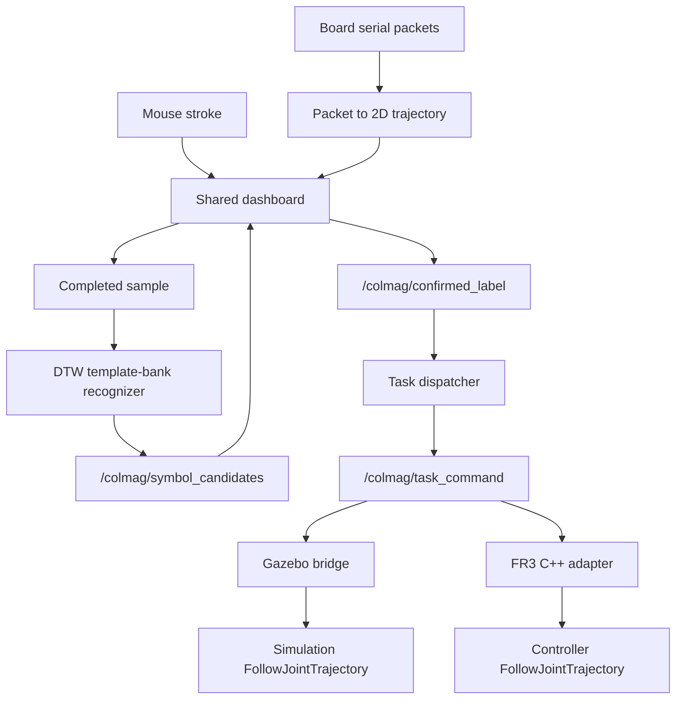

# Architecture

## Supervised control path

The system has four distinct decision boundaries:

1. trajectory completion;
2. recognition and candidate ranking;
3. explicit human confirmation;
4. dispatcher acceptance and backend routing.

No recognizer component owns `/colmag/task_command`.

## Dual-mode ownership

The latched `/colmag/control_mode` state has exactly two values: `TASK` and
`TELEOP`. `TASK` admits the supervised recognition/confirmation/dispatch route.
`TELEOP` blocks new task dispatch and admits the continuous Cartesian adapter.
Mode selection and backend/hardware authorization are independent.

| Backend | `TASK` | `TELEOP` |
| --- | --- | --- |
| Gazebo | DTW confirmation to task bridge | Keyboard input to shared Cartesian core |
| Real FR3 | Discrete FR3 task adapter | Magnetic-board input to shared Cartesian core |

See [Dual-Mode Teleoperation](DUAL_MODE_TELEOPERATION.md) for routes, ownership
transitions, validation evidence, and the physical-runtime boundary.

## Component ownership

| Responsibility | Primary implementation |
| --- | --- |
| Board packet conversion | `colmag_ros/scripts/raw_packet_to_trajectory_2d_node.py` |
| Shared Board/Mouse dashboard | `colmag_ros/scripts/magnetic_trajectory_dashboard_node.py` (see [Dashboard modules](#dashboard-modules)) |
| DTW ranking | `colmag_ros/scripts/trajectory_symbol_top3_recognizer_node.py` |
| DTW features, bank helpers, gates | `colmag_ros/src/colmag_ros/dtw_bank_features.py`, `dtw_template_bank_tools.py`, `recognition_uncertainty.py` |
| Dispatcher | `colmag_ros/scripts/task_dispatcher_node.py` |
| Control-mode source | `colmag_ros/scripts/control_mode_node.py` |
| Cartesian input | `colmag_ros/scripts/keyboard_cartesian_teleop_node.py` |
| Shared Cartesian core | `colmag_ros/src/fr3_cartesian_teleop_core.cpp` |
| Cartesian adapter (both backends) | `colmag_ros/src/colmag_fr3_cartesian_teleop_adapter.cpp` |
| Gazebo robot-body bridge | `colmag_gazebo_stub/scripts/fr3_gazebo_visible_task_bridge_node.py` |
| FR3 task adapter | `colmag_ros/src/colmag_fr3_task_trajectory_adapter.cpp` |
| FR3 C++ safety helpers | `colmag_ros/src/fr3_*_safety.cpp`, `real_fr3_command_admission.cpp` |
| Shared parameter coercion | `colmag_ros/src/colmag_ros/param_utils.py` |
| Runtime packaging | `docker/` |

## Dashboard modules

The dashboard node holds start-up, ROS topic callbacks, and the main loop. Its window
behavior comes from mixin classes in `colmag_ros/src/colmag_ros/`:

| Mixin module | Concern |
| --- | --- |
| `dashboard_layout.py` | Tk window layout |
| `dashboard_canvas_view.py` | canvas drawing, coordinate mapping, hit tests |
| `dashboard_sample_capture.py` | trajectory sampling, drawing-sample lifecycle, Board clutch state |
| `dashboard_preview_controls.py` | preview, confirm, and candidate display controls |
| `dashboard_ocr_panel.py` | OCR canvas mode |

The mixins call pure, ROS-free helpers that the tests exercise directly:

| Helper module | Concern |
| --- | --- |
| `dashboard_config.py` | read-once, immutable node parameters |
| `dashboard_geometry.py` | geometry, hit tests, Board clutch decision |
| `dashboard_points.py` | point and stroke helpers |
| `dashboard_dwell_timer.py`, `dashboard_dwell_status.py` | dwell timing and status text |
| `dashboard_controller_input.py` | dwell and confirmation decisions |
| `dashboard_candidate_display.py` | candidate formatting |
| `dashboard_confirm_publisher.py` | confirmation payload |
| `dashboard_sample_lifecycle.py`, `dashboard_trajectory_processing.py` | real-board sample lifecycle, display bounds, writing gate |
| `preview_interaction.py`, `preview_recognition.py` | preview state and preview-only recognition |

`tests/dashboard_harness.py` builds a real node with fake `rospy`, `std_msgs`, and `tkinter` modules, so tests run without a display or a ROS master.

## Frontend profiles

The neutral frontend aliases are `dtw_mouse_demo_frontend.launch` and `dtw_real_board_demo_frontend.launch`. They share recognizer and dashboard code but differ in sample completion and interaction behavior. GUI-only use can disable confirmed-label publication and omit dispatcher/backend components.

## Recognition

The tracked bank uses schema `colmag_dtw_template_bank.v1`. Each template stores label, normalized trajectory data, and provenance fields such as source type, source file identifier, source backend, and y-flip state. Ranking uses DTW distance plus confidence and margin gates.

## Execution separation

Gazebo and FR3 are separate backends:

- Gazebo receives accepted tasks through a simulation-only bridge and rejects real-robot control claims.
- FR3 receives accepted tasks through a C++ adapter with freshness, deduplication, limits, lifecycle ownership, and final-state checks.

The same task name does not imply the same safety qualification across simulation and hardware.

## Compatibility

The `colmag` namespace stays in package names, topics, launch files, and configuration paths, because imports, launch includes, install rules, and topic contracts depend on it. Reader-facing branding is neutral. The README lists the few runtime identifiers that keep the `m104` milestone prefix.
